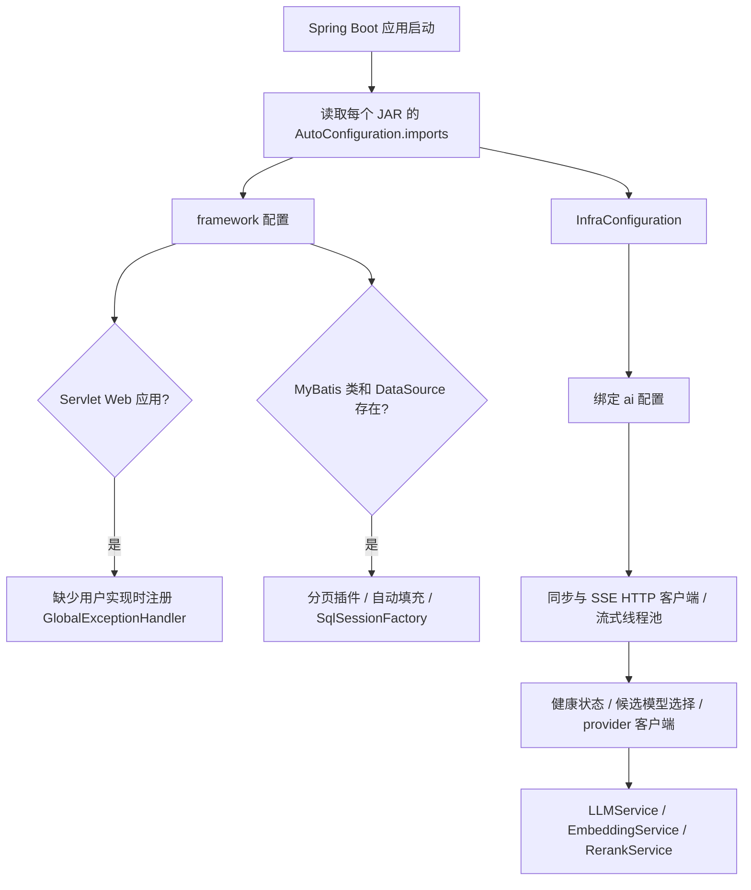
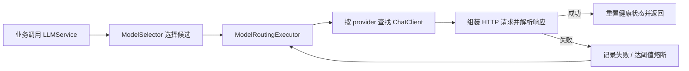

# RAgent 基础层

从 RagTest 迁移的 Java 17 / Spring Boot 4.0.1 基础模块。Maven groupId 和 Java 根包统一为 `org.puregxl.ragent`。

| 目录 | artifactId | 作用 |
| --- | --- | --- |
| 根工程 | ragent-parent | 聚合构建、统一依赖版本与编译/测试插件 |
| framework | ragent-framework | 公共 DTO、统一响应、异常处理、SSE、MyBatis-Plus 配置、MQ 接口 |
| infra | ragent-infra | 模型客户端、聊天/Embedding/Rerank 路由、故障切换、健康状态、Token 估算 |
| rag | ragent-rag | 可运行应用、模型能力接口、知识库管理及集成测试 |

依赖方向为 `业务应用 → ragent-infra → ragent-framework`。只需要 Web/公共约定时，可以单独引入 framework。framework/infra 为普通基础库 JAR；rag 是可执行 Spring Boot 应用。

## 构建

Maven 必须使用 JDK 17。macOS 示例：

```bash
export JAVA_HOME=$(/usr/libexec/java_home -v 17)
mvn clean verify
```

本地其他项目需要使用这些 SNAPSHOT 时执行 `mvn clean install`。IDEA 的 Maven importer/runner JDK 同样选择 17，重新加载根 POM。

本次在已有本地缓存上执行 `mvn -o clean verify`；首次补齐少量公开依赖时，使用临时 settings 指向 HTTPS 公共仓库，没有修改用户全局 Maven 配置。现有全局配置中的内网 HTTP 仓库仍需在其所属项目中单独管理。

## 业务项目引入

业务项目使用 Spring Boot 4.0.1 / Java 17，对齐依赖版本后引入：

```xml
<dependency>
    <groupId>org.puregxl.ragent</groupId>
    <artifactId>ragent-infra</artifactId>
    <version>1.0-SNAPSHOT</version>
</dependency>
```

应用入口使用正常的 `@SpringBootApplication` 即可；无需扫描 `org.puregxl.ragent`。普通 Java 项目必须先启动 Spring Boot 自动配置，单纯添加 JAR 不会创建 Spring Bean。

## 自动装配流程



装配入口位于各模块 `src/main/resources/META-INF/spring/org.springframework.boot.autoconfigure.AutoConfiguration.imports`。

1. Spring Boot 从依赖 JAR 读取 imports，不依赖启动类的包扫描范围。
2. framework 在 Servlet Web 场景注册统一异常处理；非 Web 容器不会加载异常处理器。
3. 数据库扩展检查可选 MyBatis 类及现有 `DataSource`。没有数据源就跳过，也不会主动创建数据库连接。
4. infra 将 `ai.*` 绑定到 `AIModelProperties`，注册共享资源、模型客户端和路由服务；启动过程中不调用模型接口。
5. 自动配置通过 `@ConditionalOnMissingBean` 让业务 Bean 优先。`ragent.infra.enabled=false` 可整体禁用 infra。

## 模型配置及调用

将配置放到业务应用自己的 `application.yml`，基础库本身不携带 application.yml、API Key 或真实服务地址：

```yaml
ai:
  providers:
    ollama:
      url: ${OLLAMA_BASE_URL:http://localhost:11434}
      endpoints:
        chat: /v1/chat/completions
        embedding: /v1/embeddings
  chat:
    default-model: local-chat
    candidates:
      - id: local-chat
        provider: ollama
        model: ${OLLAMA_CHAT_MODEL:qwen3:8b}
        priority: 10
        enabled: true
  embedding:
    default-model: local-embedding
    candidates:
      - id: local-embedding
        provider: ollama
        model: ${OLLAMA_EMBEDDING_MODEL:nomic-embed-text}
  rerank:
    default-model: passthrough
    candidates:
      - id: passthrough
        provider: noop
  selection:
    failure-threshold: 2
    open-duration-ms: 30000
```

上述模型名是示例，需要在自己的模型服务中准备。百炼、硅基流动提供商配置通过 `ai.providers.<provider>.api-key` 和环境变量传入，不将密钥写入基础库。

```java
@Service
@RequiredArgsConstructor
public class AssistantService {
    private final LLMService llmService;

    public String answer(String prompt) {
        return llmService.chat(prompt);
    }
}
```

接口包分别为 `org.puregxl.ragent.infra.chat.LLMService`、`infra.embedding.EmbeddingService`、`infra.rerank.RerankService`。公共入参和结果统一位于 `org.puregxl.ragent.framework.convention`，原有 infra 下的重复 DTO 已合并，`RetrievedChunk.docId` 保留。

一次同步调用的流程：



候选模型按首选模型、priority 排序，过滤禁用、不支持思考模式和不可用模型。失败后尝试下一候选，全部失败抛出异常；显式传入 modelId 的调用只使用指定模型。Embedding 与 Rerank 复用选择及故障切换机制。

流式调用使用独立 HTTP 客户端和 `modelStreamExecutor`，解析 SSE 后通过 `StreamCallback` 返回增量内容；首包未成功时可以尝试下一候选，首包提交后不会把另一模型的输出混进同一响应。返回的 `StreamCancellationHandle` 应在用户取消、断连或应用停机时调用 `cancel()`。默认线程池在容器关闭时执行 `shutdown`，已开始的流式调用需要业务侧主动取消。

## 扩展与覆盖

- 自定义 `LLMService`、`EmbeddingService`、`RerankService` 或 `TokenCounterService` Bean，会替换相应默认服务。
- 自定义 HTTP/线程资源须使用 `syncHttpClient`、`streamingHttpClient`、`modelStreamExecutor` 名称。HTTP 参数使用明确的 `@Qualifier`，不会被其他 `@Primary` 客户端误替换。
- 自定义 `ChatClient`、`EmbeddingClient`、`RerankClient` 可新增 provider；相同 provider 的自定义实现优先于内置类，Bean 名可以不同。两个自定义实现声明同一 provider 会明确拒绝启动，避免不确定的路由。
- provider 名称使用枚举约定的小写值：`ollama`、`bailian`、`siliconflow`、`noop`。自定义 provider 的配置 key 与 `provider()` 返回值必须一致。
- 自定义 `GlobalExceptionHandler`、`MybatisPlusInterceptor`、`MetaObjectHandler`、`SqlSessionFactory` 会使对应默认 Bean 退让。

## 数据库与 MQ 的边界

源项目 framework 引入 Redis/Redisson、RocketMQ、Sa-Token/MyBatis starters，但实际模块中没有相应 Redis/MQ 实现。本次保留已存在的源码能力，使用必要的核心依赖；不把完整外部系统启动器传递给模型调用方。

数据库相关 MyBatis-Plus、MyBatis-Spring、Spring JDBC 为可选依赖。需要数据库时，消费应用显式引入 `spring-boot-starter-jdbc`、数据库驱动、`mybatis-plus-spring:3.5.14`、`mybatis-plus-jsqlparser:3.5.14` 和 `mybatis-spring:3.0.5`，配置数据源并用 `@MapperScan` 注册自己的 Mapper。分页沿用源项目的 MySQL 方言；其他数据库可自定义 `MybatisPlusInterceptor`。

`MessageQueueProducer`、`TransactionChecker` 目前只定义契约。消费应用使用 MQ 时须显式引入 RocketMQ 客户端及自己的生产者实现；引入本基础库不会自动连接 NameServer。Redis、鉴权拦截器和业务配置不在本次迁移范围内。

基础层迁移本身无需业务表变更。知识库业务使用 `ragent` 库的 `knowledge_base`、`knowledge_document`、`knowledge_chunk` 三张表，初始化脚本见 `rag/src/main/resources/db/mysql`；知识库 CRUD 复用这些表，无额外 DDL 或配置表 DML。保留的填充处理器仅为实体已有的 `createTime`、`updateTime`、`delFlag`、`compressedFlag` 提供默认值；是否参与填充还取决于业务实体映射，不会创建这些字段。

## 验证范围

当前验证：`mvn -o -pl rag -am -Dknowledge.mysql.test=true -Dknowledge.storage.test=true clean verify` 成功，52 个测试通过（framework 5、infra 10、rag 37，包含真实 MySQL 知识库测试 7 个、RustFS/MySQL 上传联调测试 3 个）。默认构建跳过需要显式开启的 MySQL 和 RustFS 集成测试。

自动测试覆盖：独立自动发现、配置绑定、无数据源启动、有数据源装配、可选 MyBatis 类缺失、Web 异常处理及用户覆盖、服务覆盖、禁用开关、线程池关闭、同步/SSE 资源隔离、同 provider 自定义覆盖，以及首选模型失败后的切换和熔断。

模型测试不访问真实模型、Redis 或 MQ；显式启用的知识库集成测试会连接本地 MySQL，并在事务结束后回滚测试数据。真实服务的鉴权、网络、模型响应协议及业务联调仍需在消费应用环境中验证。

## Spring Boot 应用与跨模块测试

`rag`（`ragent-rag`）提供标准 `RagApplication` 启动类，通过自动装配接入 framework/infra，无需跨模块扫描。执行 `mvn -pl rag -am clean package` 后可运行 `java -jar rag/target/ragent-rag-1.0-SNAPSHOT.jar`。

运行 `mvn -pl rag -am test` 验证正式应用的自动装配及本地模型 HTTP 协议链路。启动、配置和接口示例见 [rag/README.md](rag/README.md)。


## 知识库管理

启用 `mysql` profile 后提供知识库创建、修改、逻辑删除、详情、分页及启用/禁用接口。默认连接本地 `ragent` 数据库，数据库环境变量和接口说明见 [rag/README.md](rag/README.md#知识库管理)。文档上传已接入 RustFS 和 MySQL，入口为 `/knowledge-base/{kb-id}/docs/upload`；自动解析、切分和 Chunk 管理尚未接入。
